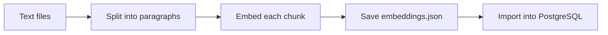
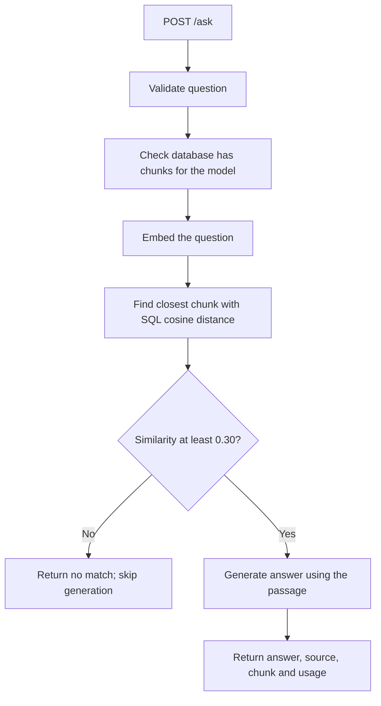

# Knowledge assistant — project walkthrough

Working core through Day 34. The Day 35 walkthrough and Day 36 cleanup improvement are complete.

## Problem

The assistant answers questions using local company-policy documents. It
retrieves a passage, asks a model to answer from that passage, and returns the
answer with its source filename, chunk number, similarity score, and token usage.

The current practice collection has two fictional documents and four chunks:
three in `sample-policy.txt` and one in `remote-work-policy.txt`.

## Prepare the documents



The loader reads `.txt` files directly inside `documents/`. Each non-empty
paragraph becomes a chunk. Chunk numbering starts at 1 for each file, so
`source` and `chunk_id` together identify a database row.

The builder embeds all loaded chunks with `text-embedding-3-small` and saves
their text, metadata, and 1,536-value vectors to a JSON cache. Importing that
cache copies the rows into PostgreSQL without another model call. The importer
checks that cached text and metadata match the current files, then updates
current source/chunk pairs and removes obsolete pairs in one transaction.

## Answer a question



PostgreSQL orders cosine distance from smallest to largest. The application
converts distance to similarity with `1 - distance`, then applies the trial
minimum of `0.30`. This score is not a confidence percentage.

A matched passage can still lack the requested detail. In that case, the prompt
instructs the model to say the passage contains insufficient information.
`generation: completed` means generation finished; it is not a quality verdict.
Source metadata identifies the supplied passage, and a person must still check
whether that passage supports the answer.

## Where the behavior lives

| File | Responsibility |
| --- | --- |
| [document_loader.py](../document_loader.py) | Load text files and split paragraphs |
| [build_index.py](../build_index.py) | Create embeddings and write the cache |
| [import_embeddings.py](../import_embeddings.py) | Copy cached chunks into PostgreSQL |
| [pgvector_search.py](../pgvector_search.py) | Embed a question, search, and apply the threshold |
| [ask_document.py](../ask_document.py) | Generate from a matched passage or skip generation |
| [knowledge_api.py](../knowledge_api.py) | Validate HTTP input/output and map errors |
| [evaluate_postgres.py](../evaluate_postgres.py) | Compare retrieved source/chunk pairs with expected results |
| [test_knowledge_api.py](../tests/test_knowledge_api.py) | Check API behavior using simulated dependencies |

## Results and their limits

| Check | Recorded result | What it establishes |
| --- | --- | --- |
| Stored documents | Two sources, four chunks; counts checked directly | Both documents have database rows |
| Retrieval evaluation | Reported 6/6 on Day 34 | Expected source/chunk pairs for six development queries |
| Answer review | Supported remote-work and support-hours answers reported | Those two answers were checked against their passages |
| Automated API tests | Reported 14 passing on Day 33 | Validation, metadata, error mapping, and simulated database failure |
| Full test suite | Reported 32 passing on Day 33 | Classifier and knowledge API tests passed together |
| Database failure | Dedicated test rerun passed with 503 and no model calls | A failed initial connection is not presented as no match |
| Collection cleanup | Day 36 reported six rows reduced to four; repeat removed zero | Removed practice rows for an obsolete file and paragraph; retained both real chunk-1 pairs |
| Import validation tests | Day 37 reported eight passing; 40 total tests | Reject stale/incomplete caches before a connection; use temporary files and a fake connection |

Six development queries are too few to establish general retrieval accuracy.
Automated API tests use simulated responses and do not measure real answer quality.

## Outcomes and model usage

| Situation | HTTP result | Model calls in this path |
| --- | --- | --- |
| Invalid or blank question | 422 | None |
| Database connection fails before search | 503 | None |
| Closest chunk is below the threshold | 200, generation skipped | One query embedding |
| Accepted passage and successful generation | 200, generation completed | One query embedding and one generation |
| Accepted passage lacks the answer | 200 if generation succeeds; model instructed to decline | One query embedding and one generation |

These counts assume successful model requests where applicable. A database
failure after the query embedding has been requested can still leave embedding
usage incurred. `/health` checks that the server responds; it does not check
database or provider readiness.

## Run locally

For first-time schema setup, use [Day 31](day-31.md). For loading both documents,
use [Day 34](day-34.md). Building embeddings incurs model usage; importing an
existing cache does not. The local `.env` needs `OPENAI_API_KEY` and
`KNOWLEDGE_DATABASE_URL`.

Once setup and import are complete, run from the project root:

```bash
source .venv/bin/activate
docker compose -f compose.knowledge.yml up -d --wait vector-db
uvicorn knowledge_api:app --host 127.0.0.1 --port 8001 --reload
```

Open <http://127.0.0.1:8001/docs>. Submitting valid questions can incur model
usage. The classifier uses its own Compose file and port 8000.

## Current limits and next improvement

The assistant currently handles local `.txt` files and retrieves one paragraph
per question. It has no document-upload interface or source filter. Large
paragraphs are not split to a token limit.

Editing a text file does not update the live search by itself. The builder must
refresh its embeddings and the importer must update PostgreSQL. The importer
now synchronizes the complete cached collection, including deletion of obsolete
rows. It rejects stale or empty caches. Files should stay unchanged during an
import, and imports should run one at a time. The threshold has only been tried
on this small collection.

The selected cleanup improvement was completed in [Day 36](day-36.md).
[Day 37](day-37.md) added automated checks for validation before a database
connection. [Day 38](day-38.md) checks rollback with the real importer and a
separate practice database.
